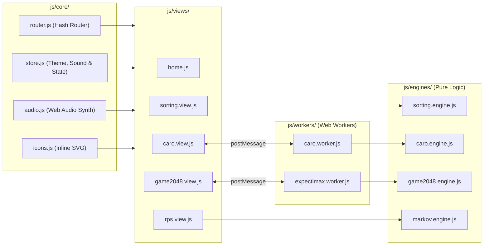

# KH / ALGO LAB

Interactive algorithm laboratory & real-time telemetry suite built with zero-build Vanilla ES Modules and Web Workers.

**Live Demo:** https://huykhiemm.github.io/arcarde/

---

## Core Modules & Algorithms

| Module | Algorithms & Data Structures | Complexity | Optimization & Telemetry |
| :--- | :--- | :--- | :--- |
| **Sorting Visualizer** | 7 ES6 Generator algorithms: Bubble, Insertion, Selection, Quick, Merge, Heap, Shell | `O(n log n)` – `O(n²)` time; `O(1)` – `O(n)` space | In-place DOM bar height & class mutation at 60fps (zero `innerHTML` rebuilds), live comparison/swap counters |
| **Caro (Gomoku) AI** | 15×15 Minimax + Alpha-Beta Pruning + Move Ordering | `O(b^(d/2))` effective with pruning | Open / half-open / split-pattern scoring across 72 precomputed lines, candidate radius pruning, offloaded to `caro.worker.js` with live node & prune-rate telemetry |
| **2048 Expectimax** | Expectimax search over 4×4 board state | Adaptive depth `3`–`6` plies | `Uint16Array` 16-bit row lookup tables, Transposition Table (`Map` / cache hits), Probability Pruning (`p ≥ 0.0001`), >3M nodes/s on `expectimax.worker.js` + 4-direction EV overlay |
| **RPS Markov** | 3-gram pattern matching + 1st-order Markov transition matrix + Frequency fallback | `O(1)` per-round update & lookup | Sliding window (`30` rounds), layered prediction confidence, live 3×3 transition matrix heatmap |

---

## Architecture

Zero-build **Vanilla ES Modules** (`type="module"`) with a hash-based router (`#/`, `#/sorting`, `#/caro`, `#/2048`, `#/rps`) and strict separation between pure algorithm engines, background Web Workers, and DOM views.

### v4.2 — Kinetic Monograph & Unified Tactile Audio
- **Editorial Typography & Tactile Surfaces:** Pairs `Newsreader` (editorial serif display titles with `text-wrap: balance`) with `Inter` (UI) and `JetBrains Mono` (`tabular-nums` telemetry), subtle static paper grain (`feTurbulence`), top-edge card highlights, and `140ms` button press physics.
- **Home Specimen Showcase & Choreography:** Four technical SVG specimen diagrams (Sorting bars, Caro 5-in-a-row, 2048 snake path, RPS Markov cycle) with self-drawing strokes, hover micro-motions, cursor sheen (`@media (hover: hover)`), stepped kinetic highlight on *"từng bước."*, and staggered route entrance (`prefers-reduced-motion` compliant).
- **Unified Web Audio Synth (`js/core/audio.js`):** Zero-asset procedural audio controlled by a global Topbar toggle (`localStorage`, default **OFF**): triangle sweep for Sorting, wood/stone clicks + win chord for Caro, mechanical slide + throttled pentatonic marimba merges for 2048, and tactile switch/interval feedback for RPS.



### Worker Subpath Compatibility

Both Web Workers are instantiated using relative URL resolution so the app works seamlessly both at root (`/`) and on GitHub Pages subpaths (`/arcarde/`):

```js
new Worker(new URL('../workers/caro.worker.js', import.meta.url), { type: 'module' });
new Worker(new URL('../workers/expectimax.worker.js', import.meta.url), { type: 'module' });
```

---

## Local Development

ES Modules (`type="module"`) and Module Web Workers require HTTP(S) rather than `file://` due to browser CORS restrictions. Serve the repository root with any static HTTP server:

```bash
python -m http.server 8000
```

Then open `http://localhost:8000` in your browser.
